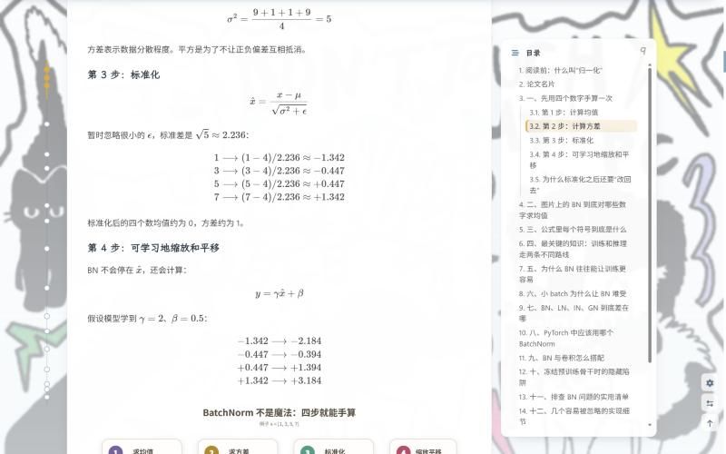
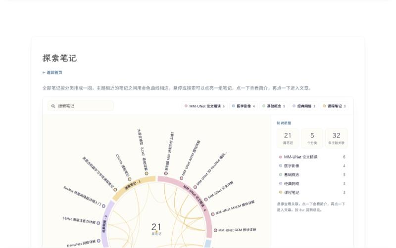
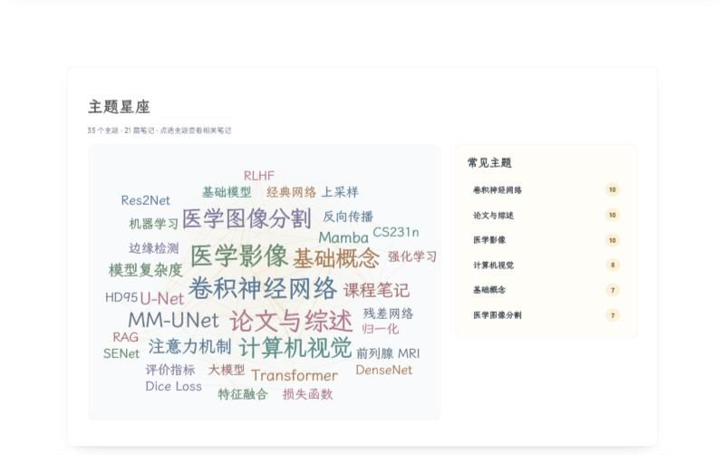

# Soong AI Notes

> 机器学习、深度学习与医学影像学习笔记 · <https://soong-a.github.io/>

一个关于机器学习、深度学习、计算机视觉与**医学图像分割**的学习笔记站。目前有 21 篇笔记，
从课程基础一路写到 MM-UNet 论文精读，每一篇都有**中文与英文两个版本**。

<table>
<tr>
<td width="50%"></td>
<td width="50%"></td>
</tr>
<tr>
<td align="center">首页 · 最新文章</td>
<td align="center">文章页 · LaTeX 公式 + 常驻目录</td>
</tr>
<tr>
<td width="50%"></td>
<td width="50%"></td>
</tr>
<tr>
<td align="center"><a href="https://soong-a.github.io/explore/">知识星图</a></td>
<td align="center"><a href="https://soong-a.github.io/tags/">主题星座</a></td>
</tr>
</table>

---

## ⚠️ 这个仓库里是什么

**这个仓库存放的是构建产物，不是源码。**

站点由另一个 Hexo 工程用 `hexo deploy` **强制推送**到本仓库的 `main` 分支。也就是说：

- 这里的 HTML、CSS、JS 都是生成的；
- **直接在本仓库提交的修改会在下一次部署时被覆盖**；
- 发现内容问题，请走下面的「反馈」，不要在这里提 PR。

---

## 📚 笔记内容

| 分类 | 篇数 | 大致内容 |
| --- | --- | --- |
| MM-UNet 论文精读 | 6 | 一篇前列腺 MRI 分割论文的逐模块精读：背景、整体架构、Res2Net 编码器、AFFM、GCM、MACM |
| 基础概念 | 5 | 参数量、GFLOPs、BatchNorm、上采样与转置卷积等「看论文时绕不开」的量和算子 |
| 医学影像 | 4 | U-Net 结构、Dice Loss、Dice/IoU/HD95 评价指标、医学影像模型全景 |
| 经典网络 | 3 | ResNet、DenseNet、SENet |
| 课程笔记 | 3 | 机器学习专项课程、CS231n、大模型基础 |

写作上有几个固定习惯：

- **先讲为什么，再讲怎么算。** 公式之前通常有一个尽量朴素的类比或一个能手算的小例子。
- **把容易踩的坑单独列出来。** 多数长文结尾都有「最容易犯的错误」和自测题。
- **交叉引用。** 相关笔记之间互相链接，并在文末给出「相关阅读」。

## ✨ 站点特性

- **一个 URL，两种语言。** 中英文正文渲染进同一个页面，由导航栏的 `中 / EN` 开关切换，
  切换不跳转、不刷新；界面文案、标签、分类同步翻译。
- **LaTeX 公式。** 含公式的笔记用 MathJax 渲染。
- **常驻目录。** 文章页右侧目录在滚动时固定可见，并高亮当前章节。
- **知识星图。** [`/explore/`](https://soong-a.github.io/explore/) 把笔记按分类排成扇区，
  并用共享标签连出笔记之间的关系。
- **主题星座。** [`/tags/`](https://soong-a.github.io/tags/) 是一个标签云与关系图的混合体，
  选中一个主题就能看到它下面的笔记。
- **全站搜索。** 标题、摘要与正文，中英文都能搜。
- **手绘风格插图。** 结构示意图是手写的 SVG，不是截图。

## 🛠 技术栈

| | |
| --- | --- |
| 静态站点生成器 | [Hexo](https://hexo.io/) 7.3 |
| 主题 | [Butterfly](https://github.com/jerryc127/hexo-theme-butterfly)（本地有较多定制） |
| 公式 | MathJax 3（CDN，浏览器端渲染） |
| 图表 | Mermaid + 手写 SVG |
| 托管 | GitHub Pages |
| 部署 | `hexo-deployer-git` |

双语、知识星图、主题星座、搜索索引和 SEO 路由都由源码工程 `scripts/` 下的几个
Hexo 生成器实现，不依赖第三方服务。

## 💬 反馈

读到讲错的地方、公式写反了、或者某段看不懂，欢迎开
[Discussions](https://github.com/Soong-A/Soong-A.github.io/discussions) 告诉我 ——
站内 [`/feedback/`](https://soong-a.github.io/feedback/) 页面会同步展示这些讨论。

## 📄 许可

笔记正文版权归作者所有。站点使用的 Butterfly 主题遵循其
[Apache-2.0](https://github.com/jerryc127/hexo-theme-butterfly/blob/master/LICENSE) 许可。

---

<b>English</b>

 

**Soong AI Notes** — study notes on machine learning, deep learning, computer
vision and **medical image segmentation**, at <https://soong-a.github.io/>.
21 notes so far, from course fundamentals through a module-by-module reading of
the MM-UNet paper. Every note exists in both Chinese and English.

**This repository holds build output, not source.** The site is force-pushed
here by `hexo deploy` from a separate Hexo project, so anything committed
directly to this repository is overwritten on the next deploy. Please report
content problems through
[Discussions](https://github.com/Soong-A/Soong-A.github.io/discussions) rather
than opening a pull request here.

What the site does:

- **One URL, two languages.** Both language bodies render into the same page;
  the `中 / EN` switch in the nav bar swaps them without a reload, and the
  interface strings, tags and categories follow.
- **LaTeX formulas**, rendered with MathJax 3.
- **A table of contents** that stays pinned beside the text while you scroll and
  highlights the section you are in.
- **A knowledge map** at [`/explore/`](https://soong-a.github.io/explore/) that
  lays the notes out by category and links the ones sharing topic tags.
- **A topic constellation** at [`/tags/`](https://soong-a.github.io/tags/).
- **Full-text search** over titles, summaries and bodies, in both languages.
- **Hand-authored SVG diagrams** rather than screenshots.

Built with Hexo 7.3 and a locally modified Butterfly theme, hosted on GitHub
Pages. The bilingual switch, knowledge map, constellation, search index and SEO
routes are all Hexo generators in the source project — no third-party services.

